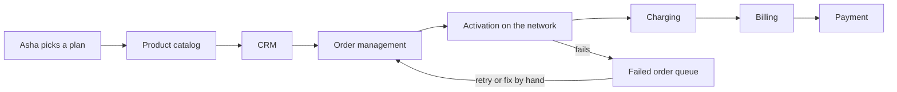

# Order to Cash: One Customer Journey

A customer, Asha, wants a postpaid plan. This is what happens in the systems behind it. Everything here is simplified for learning.

## What each step does

| Step | What it does | Example for Asha | If it goes wrong |
|------|--------------|------------------|------------------|
| Product catalog | Stores every plan, price, bundle and rule in one place | "Postpaid Plus: Rs 599, 50 GB" | A wrong price here leads to wrong bills later |
| CRM | Keeps the customer's record, contact details and support cases | Asha's profile and ID are created | Duplicate records, so the company sees two Ashas |
| Order management | Turns the choice into an order and tracks every step until it is done | Order: new connection plus Postpaid Plus | An order gets stuck halfway and the customer has no service |
| Activation | Switches on the service on the network | SIM and plan are active | Goes to the failed order queue for retry or manual fix |
| Charging | Counts what Asha uses and applies the plan rules | 42 GB used out of 50 GB | Usage is missed or counted twice |
| Billing | Adds the plan fee, extra usage and tax into a bill | Rs 599 plus tax | Wrong amounts lead to complaints and disputes |
| Payment | Collects the money and updates the account | Asha pays by UPI | Payment is not matched to the right account |

## Prepaid and postpaid
- **Prepaid:** the customer pays first. Charging must happen in real time, because the system has to stop or warn when the balance runs out. This is called online charging.
- **Postpaid:** the customer uses first and pays later. Usage records are collected and priced afterwards for the bill. This is called offline charging.
- A **convergent** system handles both in one platform, so a customer with prepaid mobile and a postpaid broadband plan can have one record.

## Terms I had to learn
- **CDR (call detail record):** a record of one usage event, such as a call or a data session
- **Rating:** working out the price of one usage record
- **Dispute:** a customer says a bill is wrong, and the company checks and may issue a credit note
- **BSS / OSS:** business support systems (customer, orders, billing) and operations support systems (the network)
